# Fracture patterns in the 3D ankle: values for review

**Status: draft. A clinician must review this before any presentation.** Laura, please check the
numbers and the pictures below, and answer the open questions at the end.

## What this is

When a rater fills in the classification form, the 3D ankle now draws the fracture: crack lines,
the fragments and a small displacement once the form is complete. The drawing is a **standard
pattern for the answers given, not a model of the patient's fracture**. Two raters who give the
same answers see the same picture. The figure says so in its caption.

Each pattern is built from 19 fixed pieces. A piece is a part of the tibia or fibula cut off by one
to six planes, plus a small move. All values live in one file,
`frontend/src/components/anatomy/fractureParams.json`. The pieces and the form answers that turn
them on do not change in this review; only their placement, size and move do.

## How the values were derived

- **Cases.** 53 anonymised cases from the study, with radiographs, CT slices or CT
  reconstructions (170 images). They cover 26 groups of AO/OTA code by Bartoníček type,
  from 44-A1 to 44-C3 and 43-B1, including cases no rater could classify.
- **Two independent readers.** Two AI readers (Claude and Codex) read every image separately and
  did not see each other's work. For each case they recorded the level, orientation, fragment
  size and displacement of each fracture, in the model's frame. The frame is millimetres from the
  centre of the tibial plafond: up is proximal, the x axis points medially and the z axis
  anteriorly.
- **Reconciliation.** For each piece the value is the median of the two readings. Where they
  differed by more than 5 mm or 15°, the relevant cases were opened again and measured; the
  tables below record each decision. Moves were then limited to 1 to 3 mm and at most 5° per
  fragment, so the picture shows the direction of displacement without exaggerating it.
- **Scale.** The readers measured on images without a common ruler, so heights first had to be
  put on the model's scale.
  - The model's distal tibia is 48 mm wide at the plafond, medial malleolus included. Its talar
    dome is 33 mm wide, the fibular tip sits 29 mm below the plafond, and the syndesmosis top is
    at 23 mm.
  - Two images with a scale confirm that the full distal tibial width (about 45 to 49 mm) is the
    right ruler, not the 30 to 35 mm one of the reading prompt. In case 38 the surgeon's "6 cm"
    line gives a tibial width of 49 mm. In case 46 the 10 cm bar on the CT rendering gives
    about 47 mm.
  - Claude had used 33 mm for the full width and corrected its heights by 1.4. Codex's heights
    sat between the two scales and were reconciled case by case.
  - Every height below is on the model's scale and is good to about ±20%.

## The eight shown paths

Each path has three pictures: the 3D view as the form opens it, and the AP and lateral views of
the result screen. Paths 3 and 4 also have a posterolateral view, because the default 3D view
does not show the posterior fragment.

### 1. Lateral malleolus only, infrasyndesmotic tip avulsion

Pieces: `fib_tip_avulsion`.

| | Value |
| --- | --- |
| Level | Transverse line 21 mm below the plafond, about 8 mm above the fibular tip |
| Orientation | Transverse, very slightly higher anteriorly |
| Fragment | The whole tip below the line, about 8 mm tall |
| Displacement | 1 mm distal, 0.5 mm lateral, 0.25 mm anterior, 1° external rotation. Talus does not move (stable) |
| Source | Images: 4 cases (44-A1 and the tip flakes of the 43-B1 case) |
| Readers | Disagreed by 10 mm. Claude put the line 6 to 8 mm above the tip (median 22 mm below the plafond); Codex put it 7 to 12 mm below the plafond. Case 3 was measured again: the line is 6 to 7 mm above the tip, so Claude's reading was taken. The old value (10 mm below) was too high. |

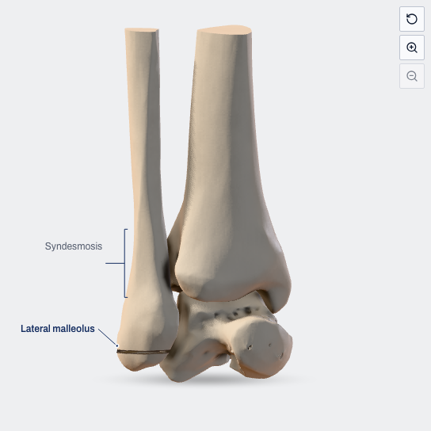
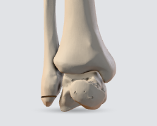

### 2. Lateral malleolus only, transsyndesmotic spiral (Weber B)

Pieces: `fib_trans_spiral`.

| | Value |
| --- | --- |
| Level | Centre 13 mm above the plafond. The line runs from about 2 mm (anteroinferior) to 25 mm (posterosuperior) |
| Orientation | Anteroinferior to posterosuperior, 50° to the horizontal, slightly higher laterally |
| Fragment | The distal fibula below the line |
| Displacement | 2.3 mm posterior, 1.5 mm lateral, 1.3 mm proximal (shortening), 4° external rotation. Talus does not move (one malleolus) |
| Source | Images: 22 cases (44-B1, B2, B3 SER, and unclassified cases with a Weber B line) |
| Readers | Agreed. Line from 0 to 1 mm up to 24 to 27 mm (Codex), or 2 to 28 mm (Claude); the angle was 51° (Codex) or 45 to 55° (Claude). The line's top is now 2 mm above the model's syndesmosis line, and the test that kept Weber B pieces below 23 mm now allows 26 mm. |

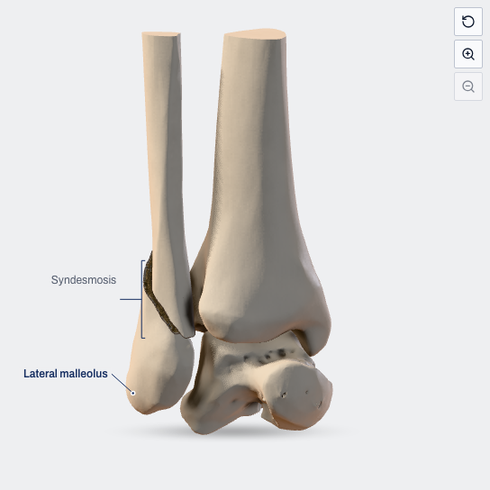
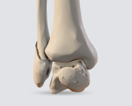
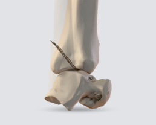

### 3. Trimalleolar: Weber B spiral, transverse medial malleolus, posterolateral fragment (Bartoníček 2)

Pieces: `fib_trans_spiral`, `med_transverse`, `post_b2`. The talus moves (three malleoli).

| | Fibula | Medial malleolus | Posterior (Bartoníček 2) |
| --- | --- | --- | --- |
| Level | As path 2 | At the plafond corner, 1 mm above the plafond | Apex 16 mm above the plafond on the posterior cortex |
| Orientation | As path 2 | Transverse, about 15° lower laterally | Oblique: runs from behind the incisura (lateral) to the posterior cortex, shallower medially |
| Fragment | As path 2 | The whole malleolus below the corner (about 15 mm wide) | About 20% of the plafond's anteroposterior depth centrally, 37% at the incisura (a local maximum, where the fragment is deepest); ends medially at x = 6 mm |
| Displacement | As path 2 | 1.5 mm medial and 1.5 mm distal, with no tilt | 1.3 mm proximal, 1.5 mm posterior, 0.25 mm lateral; 1.5° tilt about a mediolateral axis, posterior cortex up and articular edge slightly down |
| Source | Images, 22 cases | Images: 14 cases (44-B3, 44-C, isolated medial) | Images: 8 cases (Bartoníček 2, CT) |
| Readers | Agreed | Agreed on the level (0 vs 2 mm). They disagreed on the tilt direction (Claude valgus +3°, Codex −3°), so no tilt is drawn | Disagreed on the apex: 12 mm (Codex) vs 20 mm (Claude). Re-measuring a CT case (case 22) put the true value between the two readings, so the median (16 mm) was taken. The old apex was 15 mm. |

Talus (unstable): 2 mm lateral, 0.5 mm posterior, 4° external rotation. Both readers measured a
medial clear space of 4 to 5 mm in these groups. Codex's 3 mm / 6° for the more unstable
patterns is beyond the 3 mm / 5° limit, so the talus move was capped.

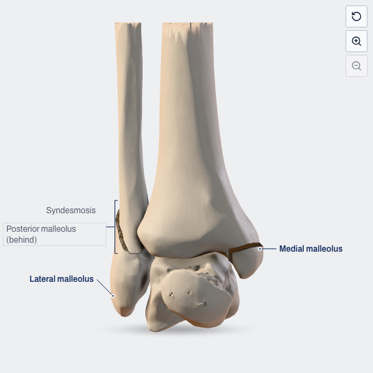
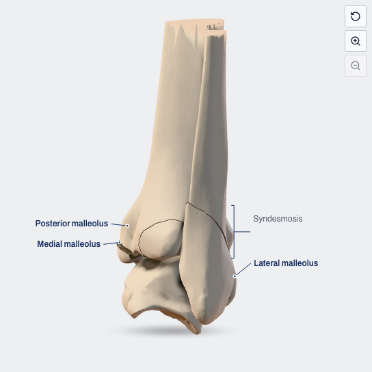
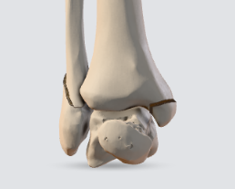

### 4. Trimalleolar with a two-part posterior fragment (Bartoníček 3)

Pieces: `fib_trans_spiral`, `med_transverse`, `post_b2`, `post_b3_pm`. The talus moves.

| | Value (posteromedial part, `post_b3_pm`) |
| --- | --- |
| Level | Apex 23 mm above the plafond on the posteromedial cortex |
| Orientation | Coronal-oblique, rising posteriorly; the lateral edge is at x = 5 mm, where it meets the posterolateral part (`post_b2`, as path 3) |
| Fragment | The posteromedial plafond and the posterior colliculus of the medial malleolus |
| Displacement | 1.8 mm proximal, 1.5 mm posterior, 0.5 mm medial |
| Source | Images: 8 cases (Bartoníček 3, CT) |
| Readers | Disagreed on the apex: 20 mm (Codex, 1 measured case) vs 25 to 38 mm (Claude, median 30). The median is 25 mm. The model's posteromedial cortex narrows above 20 mm, so the piece tops out at 23 mm. The old piece was smaller, with its apex at 18 mm. |

The fibula, medial malleolus and talus are as in path 3. In a trimalleolar ankle the medial
malleolus piece takes the posterior colliculus where the two overlap.

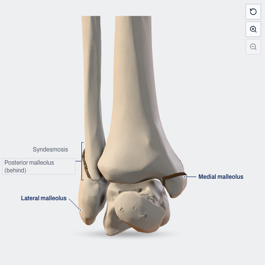
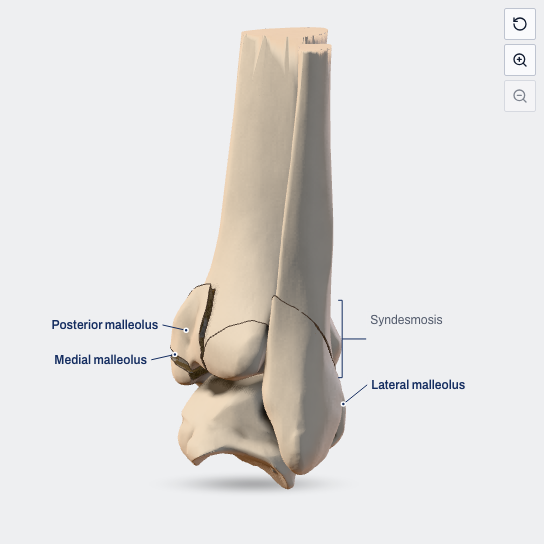

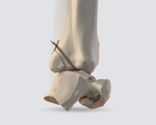

### 5. Lateral and medial, vertical medial shear with an infrasyndesmotic fibula (supination-adduction)

Pieces: `fib_infra`, `med_vertical`. The talus does not move. In supination-adduction the talus drives medially, so the lateral, externally rotated shift used for other unstable ankles would point the wrong way; the vertical shear turns it off (see the open questions).

| | Fibula (`fib_infra`) | Medial (`med_vertical`) |
| --- | --- | --- |
| Level | 9.5 mm below the plafond | From the plafond corner (x = 15 mm) up to the medial cortex at about 21 mm |
| Orientation | Transverse, very slightly oblique | Near vertical, 11° from the vertical, leaning medially as it rises |
| Fragment | The distal 19 mm of the fibula | The whole medial malleolus with its corner of the plafond |
| Displacement | 1 mm distal, 1.5° external rotation, no lateral shift | 1.3 mm medial and 1.3 mm **proximal** |
| Source | Images: 2 weak cases (44-A2, 44-A3), plus literature | Literature (AO/OTA 44-A2.3, Lauge-Hansen SA II); 1 weak case |
| Readers | 7.5 mm (Codex) vs 12 mm (Claude) below the plafond; the median was taken. Codex moved the fragment 2 mm laterally, but in supination-adduction it is avulsed in tension and stays or follows distally, so the lateral shift was removed after review | The apex was 15 to 25 mm (Codex) or 21 to 28 mm (Claude), so it was set at about 21 mm (it was 29). Both readers move the fragment proximally, pushed by the talus. The old move was distal, so the direction is reversed. |

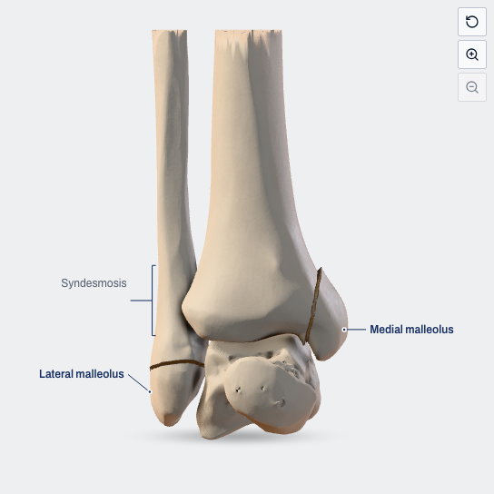
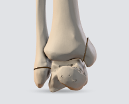
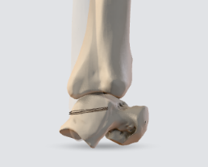

### 6. Suprasyndesmotic multifragmentary fibula (Weber C), open mortise

Pieces: `fib_supra`, `fib_supra_wedge`. No medial cut (the medial side is ligamentous). The whole
fibula and the talus move.

| | Main line (`fib_supra`) | Butterfly wedge (`fib_supra_wedge`) |
| --- | --- | --- |
| Level | Centre 48 mm above the plafond; the line spans about 42 to 53 mm | 42 to 56 mm, lateral half of the fibula |
| Orientation | Short oblique, anterosuperior to posteroinferior (pronation-external rotation), slightly higher laterally | Lateral wedge between two planes 15° from the horizontal |
| Fragment | The distal fibula below the line | About 12 mm tall |
| Displacement | 2 mm lateral and 1 mm proximal, 3° external rotation, added to the whole-fibula shift of 2 mm lateral | 1.5 mm lateral, 0.5 mm proximal |
| Source | Images: 5 cases (44-C1 and a low 44-C2) | Images: 7 cases with a lateral butterfly |
| Readers | Disagreed by 15 mm: Claude 45 mm, Codex 48 to 62 mm. Two cases with a "6 cm" ruler were measured again: case 30 at 55 to 60 mm, case 38 at 31 to 53 mm. The piece stays under 60 mm because the form defines this answer as "< 6 cm from the articular surface". Both readers agree on the obliquity, which is the reverse of the old value. | Claude only |

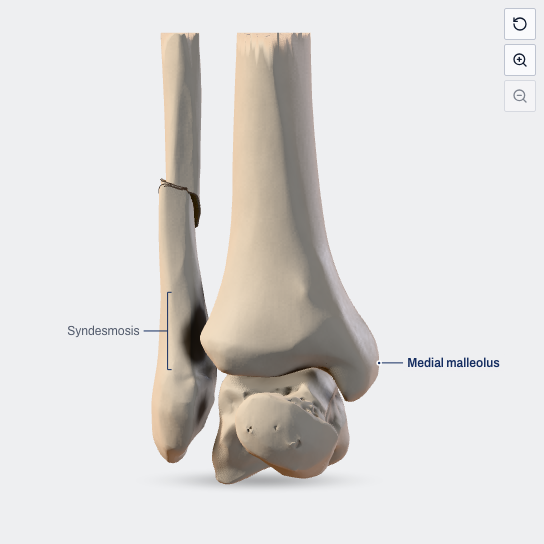
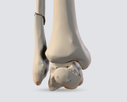

### 7. Proximal fibula (Maisonneuve) with a medial fracture

Pieces: `med_transverse` (as path 3). The fibular fracture is above the model's 100 mm of
fibula, so it is not cut; an arrow points to it. The whole fibula shifts 2 mm laterally and the
talus moves.

| | Value |
| --- | --- |
| Fibular level | About 215 to 300 mm above the plafond on leg films (3 cases); beyond the model |
| Medial | As path 3 |
| Source | Images: 3 Maisonneuve cases (44-C2/C3) |
| Readers | Agreed that it lies in the proximal third. |

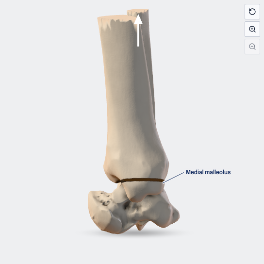
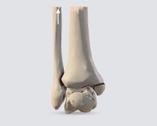
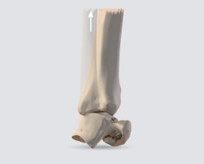

### 8. Posterior malleolus only, large fragment with metaphyseal extension, articular depression

Pieces: `post_b4`, `art_depression`. The talus does not move (one malleolus).

| | Posterior (`post_b4`) | Depression (`art_depression`) |
| --- | --- | --- |
| Level | Apex 32 mm above the plafond on the posterior cortex | The plafond surface |
| Orientation | Coronal-oblique, rising posteriorly; slightly deeper laterally (takes the incisura) | Square block |
| Fragment | About 40% of the plafond's anteroposterior depth; from the incisura to x = 14 mm, short of the medial malleolus | 8 × 8 × 4 mm block, posterolateral plafond |
| Displacement | 2 mm proximal, 1.5 mm posterior | 1.5 mm proximal (impacted) |
| Source | Images: 7 cases (Bartoníček 4, CT and lateral) | Literature: Bartoníček et al., Arch Orthop Trauma Surg 2015; AO Surgery Reference, malleoli (not seen on its own in the 53 cases) |
| Readers | Disagreed: apex 22 to 30 mm (Codex) vs 38 to 46 mm (Claude). Re-measured in case 22 on sagittal CT at about 30 mm with 36% depth. The old piece reached 57% of the depth at the plafond. | Literature only |

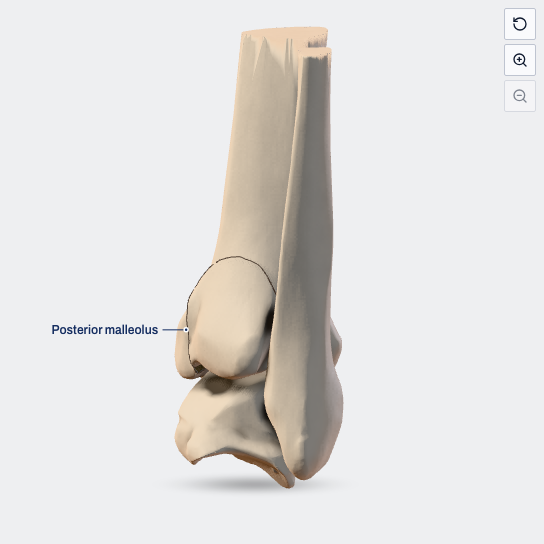
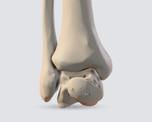
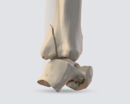

## Pieces not in the eight paths

| Piece | Drawn for | Level and shape | Move | Source |
| --- | --- | --- | --- | --- |
| `fib_trans_short` | Weber B, transverse | Centre 8 mm; short oblique, 30°, anteroinferior to posterosuperior | 1.5 lateral, 1 proximal, 1.5 posterior; 3° external rotation | Images: 4 cases (Bartoníček 3/4) |
| `fib_trans_coronal` | Weber B, oblique (pronation-abduction) | Centre 14 mm; in the coronal plane, 50°, low medially (about 6 mm) and high laterally (about 25 mm) | 2 lateral, 0.5 proximal, 0.5 posterior; 2° | Images: 5 cases (Claude only; Codex had no separate template). The angle is steeper than the old 35° |
| `fib_trans_wedge` | Weber B with several lines or a butterfly | Lateral half, from the spiral up to 21 mm | 1.5 lateral, 0.5 proximal, 0.5 posterior; 1° | Images: 6 cases |
| `fib_trans_comm_a` / `_b` | Weber B comminuted | Anterior and posterior chips, 4 to 16 mm (unchanged) | 1 anterior / 1 posterior, 0.5 proximal | Images: 2 cases / literature (AO/OTA Compendium 2018, 44-B3 and 44-C multifragmentary fibula) |
| `fib_supra_far` | Weber C more than 6 cm above the joint | 68 mm; transverse, slightly higher laterally | 2 lateral, 0.5 proximal, 1 posterior; 2.5° | Images: 6 cases (44-C2). Claude 60 to 65 mm (from the "6 cm" annotations), Codex 67 to 84 mm; median 68. The readers disagreed on the sagittal obliquity, so it is drawn transverse in that plane |
| `post_b1` | Bartoníček 1 (extraincisural) | Thin posterolateral rim outside the incisura, apex 6 mm, 12% of the depth, x −14 to −3 mm | 0.5 proximal, 1 posterior | Images: 2 cases (CT). Claude placed it posterolaterally, Codex centrally; posterolateral was kept because that is Bartoníček's definition (Bartoníček et al., Arch Orthop Trauma Surg 2015) |
| `post_pm_extraincisural` | Posteromedial extraincisural fragment | Posteromedial block, apex 10 mm, x 4 to 16 mm | 1 proximal, 1.5 posterior, 0.35 medial | Literature (AO/OTA 44-A3); 1 case |

## Proposals and open questions

These need a clinical decision. None of them is in the code yet.

1. **Generic pieces when the form never asks the type.** Some complete answer paths never ask the
   medial morphology or the Bartoníček type (for example, no CT). The figure then draws a
   transverse medial malleolus (`med_transverse`) and a posterolateral Bartoníček 2 fragment
   (`post_b2`), the commonest in the study. This shows a morphology the rater did not choose.
   Should it draw them, draw only a crack, or draw nothing?
2. **The 1.5 mm medial gap.** The transverse medial malleolus moves 1.5 mm medially and
   1.5 mm distally. In the AP view that shows as a dark gap. Is that the right amount, or should
   an undisplaced fracture be the default?
3. **Medial malleolus tilt.** The readers disagreed on its direction (valgus versus varus), so the
   fragment is not tilted. Which way should it tip, if at all?
4. **Maisonneuve.** The model holds only the distal 100 mm of the fibula, so the proximal
   fracture is an arrow and the whole visible fibula shifts. Codex proposed lengthening the
   fibula to draw the cut at 215 to 290 mm. Is the arrow enough?
5. **Suprasyndesmotic obliquity.** The form does not ask the mechanism. The picture uses the
   pronation-external rotation line (anterosuperior to posteroinferior). The study also has
   pronation-abduction cases, where the line is short and lateral. Is one standard line acceptable?
6. **New pieces the readers suggested.** They are listed here only, because adding pieces changes
   the file layout:
   - an anteromedial medial fragment that comes with a large posterior fragment (Bartoníček 4 with
     44-C1, as in the AO/OTA 44-C1.3 description);
   - a broad posterior partial-articular split for the 43-B1 (pilon) case;
   - a separate, higher posterolateral part for Bartoníček 3, rather than reusing the
     Bartoníček 2 piece;
   - a separate Weber A transverse line versus a tip flake: the study has both under 44-A1.
7. **Talus in supination-adduction.** With a vertical medial shear the talus is drawn in place. Should it show a small medial shift (about 1 mm) instead?
8. **Talus shift.** One shift is used for every other unstable ankle: 2 mm lateral, 0.5 mm posterior,
   4° external rotation. Codex suggested 3 mm and 6° for the more unstable patterns, beyond the
   current limit.
9. **Precision.** All heights are visual estimates on downscaled images, good to about ±20%.
   Fine lines (tip avulsions, undisplaced medial malleolus) were the least certain.
